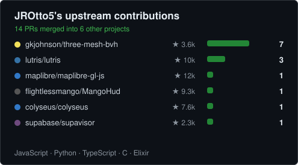

# upstream-card

**Show the pull requests you got merged into other people's projects.** upstream-card builds an SVG card and a markdown list of your merged PRs in other people's public repositories, for your GitHub profile README. It runs as a GitHub Action or a CLI and has zero dependencies.

<p align="center">
  
</p>

Most profile stat cards count everything: your own repos, forks, commits to scratch projects. Maintainers and hiring managers mostly want to know something else: **did other projects accept your work?** upstream-card counts only that. It shows PRs that were **merged**, into **public** repositories you **don't own**, grouped by project with stars and language.

## Use it in your profile README (GitHub Action)

Add the card to your profile README (the `<username>/<username>` repo):

```markdown

```

Then add `.github/workflows/upstream-card.yml`:

```yaml
name: upstream-card
on:
  schedule: [{ cron: "0 6 * * *" }]   # daily
  workflow_dispatch:
permissions:
  contents: write
jobs:
  card:
    runs-on: ubuntu-latest
    steps:
      - uses: actions/checkout@v4
      - uses: JROtto5/upstream-card@v0.1.0
        with:
          theme: dark            # or light
          top: 6                 # projects on the card
          # exclude: my-employer,someone/fork   # owners or owner/repo to leave out
          # readme: README.md    # also write the full list between the markers below
      - run: |
          git config user.name "github-actions[bot]"
          git config user.email "41898282+github-actions[bot]@users.noreply.github.com"
          git add -A && git diff --cached --quiet || git commit -m "upstream-card: refresh" && git push
```

With `readme: README.md`, the full markdown list (every project, its latest PRs with links and dates) goes between two markers you put in your README:

```markdown
<!-- upstream-card:start -->
<!-- upstream-card:end -->
```

## Use it from the command line

Node 20 or newer, no install step:

```sh
git clone https://github.com/JROtto5/upstream-card && cd upstream-card
GITHUB_TOKEN=$(gh auth token) node bin/upstream-card.js --user <login> --svg card.svg --md upstream.md
```

| Option | What it does |
|---|---|
| `--user <login>` | The GitHub user to summarize |
| `--svg <file>` | Where to write the card (default `upstream-card.svg`) |
| `--theme dark\|light` | Card theme |
| `--top <n>` | Projects on the card (default 6); the markdown list always has all of them |
| `--exclude <list>` | Comma-separated owners or `owner/repo` to leave out |
| `--since <YYYY-MM-DD>` | Only PRs merged on or after this date |
| `--md <file>` | Also write the markdown list |
| `--readme <file>` | Put the markdown list between the `upstream-card` markers in this file |
| `--json <file>` / `--from-json <file>` | Save the summary, or render from a saved one offline |

A token is optional. It raises GitHub's API rate limit from 60 to 5,000 requests an hour, and inside Actions the default `GITHUB_TOKEN` is used.

## What counts

- **Merged pull requests only.** Closed and open ones don't count.
- **Public repositories only.** The search always adds `is:public`, so private work, such as an employer's or a client's repos, never reaches a public card, even when your token can see it.
- **Not your own repositories.** The search drops repos you own (`-user:<you>`). Use `--exclude` for organizations you belong to or forks you'd rather leave out.
- **Projects are ranked** by merged PRs, then by stars, then by the most recent merge.
- **GitHub's search returns at most 1,000 results.** upstream-card reads up to 300 PRs, which covers almost everyone.

## Library

```js
import { fetchMergedPRs, fetchRepoInfo, summarize, renderSVG, renderMarkdown } from 'upstream-card';

const prs = await fetchMergedPRs('octocat', { token });
const info = await fetchRepoInfo([...new Set(prs.map((p) => p.repo))], { token });
const summary = summarize(prs, info, { top: 6 });
const svg = renderSVG(summary, { user: 'octocat', theme: 'light' });
```

## Development

```sh
npm test   # node --test, no dependencies
```

The code was reviewed with [crucible](https://github.com/JROtto5/crucible), an evidence-first AI code reviewer, before each release.

## License

MIT
