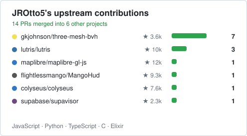

# upstream-card

**Show the pull requests you got merged into other people's projects.** upstream-card builds an SVG card and a markdown list of your merged PRs in other people's public repositories, for your GitHub profile README. It runs as a GitHub Action or a CLI and has zero dependencies.

<p align="center">
  
</p>

Most profile stat cards count everything: your own repos, forks, commits to scratch projects. Maintainers and hiring managers mostly want to know something else: **did other projects accept your work?** upstream-card counts only that. It shows PRs that were **merged**, into **public** repositories you **don't own**, grouped by project with stars and language.

## Use it in your profile README (GitHub Action)

Add the card to your profile README (the `<username>/<username>` repo):

```markdown

```

Then add `.github/workflows/upstream-card.yml`:

```yaml
name: upstream-card
on:
  schedule: [{ cron: "0 6 * * *" }]   # daily
  workflow_dispatch:
permissions:
  contents: write   # only to commit the refreshed card
jobs:
  card:
    runs-on: ubuntu-latest
    steps:
      - uses: actions/checkout@v4
      - uses: JROtto5/upstream-card@SHA_PLACEHOLDER # v0.1.0
        with:
          theme: auto            # follows the viewer's light/dark setting; or dark / light
          top: 6                 # projects on the card
          # exclude: my-employer,someone/fork   # owners or owner/repo to leave out
          # min-stars: 50        # only projects with at least this many stars
          # since: 2026-01-01    # only PRs merged on or after this date (UTC)
          # readme: README.md    # also write the full list between the markers below
      - run: |
          git config user.name "github-actions[bot]"
          git config user.email "41898282+github-actions[bot]@users.noreply.github.com"
          git add -A
          git diff --cached --quiet || { git commit -m "upstream-card: refresh" && git push; }
```

upstream-card only rewrites a file when its content changed, so a day with no new merges makes no commit. Pin the action to a commit SHA, as above, so a later change to this repository can't change what runs in yours.

With `readme: README.md`, the full markdown list (every project, with its latest PRs, links and dates) goes between these two markers in your README. If neither marker is there yet, both are added at the end of the file. A lone marker, or two in the wrong order, is an error, so nothing gets written in the wrong place:

```markdown
<!-- upstream-card:start -->
<!-- upstream-card:end -->
```

## Use it from the command line

Node 20 or newer, no install step. A token is required, because GitHub's GraphQL API has no anonymous access; only public data is read:

```sh
git clone https://github.com/JROtto5/upstream-card && cd upstream-card
GITHUB_TOKEN=$(gh auth token) node bin/upstream-card.js --user <login> --svg card.svg --md upstream.md
```

| Option | What it does |
|---|---|
| `--user <login>` | The GitHub user to summarize (not needed with `--from-json`) |
| `--svg <file>` | Where to write the card (default `upstream-card.svg`) |
| `--theme auto\|dark\|light` | Card theme; `auto` (the default) follows the viewer's light/dark setting |
| `--title <text>` | Card heading (default: `<user>'s upstream contributions`) |
| `--top <n>` | Projects on the card (default 6); the markdown list always has all of them |
| `--exclude <list>` | Comma-separated owners or `owner/repo` to leave out (`--exclude-orgs` is the same) |
| `--min-stars <n>` | Leave out projects with fewer stars |
| `--exclude-forks` | Leave out projects that are themselves forks |
| `--since <YYYY-MM-DD>` | Only PRs merged on or after this date (UTC) |
| `--md <file>` | Also write the markdown list |
| `--readme <file>` | Put the markdown list between the `upstream-card` markers in this file |
| `--json <file>` / `--from-json <file>` | Save the summary, or render from a saved one offline; the filters still apply |
| `--dry-run` | Print which files would be created or updated, and write nothing |

## What counts

- **Merged pull requests only.** Closed and open ones don't count.
- **Public repositories only.** The search always adds `is:public`, and every result's repository is checked again (`isPrivate`), so private work, such as an employer's or a client's repos, never reaches a public card, even when your token can see it. Deleted repositories are skipped.
- **Renamed or transferred projects** show under their current name, and PRs from before and after a rename count as one project.
- **Not your own repositories.** The search drops repos you own (`-user:<you>`). Use `--exclude` for organizations you belong to or forks you'd rather leave out.
- **Projects are ranked** by merged PRs, then by stars, then by the most recent merge.
- **GitHub's search returns at most 1,000 results per query.** Past that, upstream-card splits the date range into windows that each fit, so long histories are counted in full. Two limits remain, and both print a warning rather than cutting silently: a single day with more than 1,000 merged PRs, and the library's `max` option (5,000 by default), which keeps the newest PRs.

## Library

```js
import { fetchMergedPRs, summarize, renderSVG, renderMarkdown } from 'upstream-card';

const prs = await fetchMergedPRs('octocat', { token });
const summary = summarize(prs, { top: 6, minStars: 10 });
const svg = renderSVG(summary, { user: 'octocat', theme: 'light' });
```

## Development

```sh
npm test   # node --test, no dependencies; uses xmllint when it's installed
UPDATE_SNAPSHOTS=1 npm test   # after an intended change to the card's look
```

The tests cover the npm `bin` symlink, pagination past 100 results and date-window splitting past 1,000; private, deleted and renamed repositories; hostile repository names and titles (escaped, checked with xmllint); a second run changing nothing; a missing token; `--since` boundaries; and snapshots of all three themes.

The code was reviewed with [crucible](https://github.com/JROtto5/crucible), an evidence-first AI code reviewer, before each release.

## License

MIT
